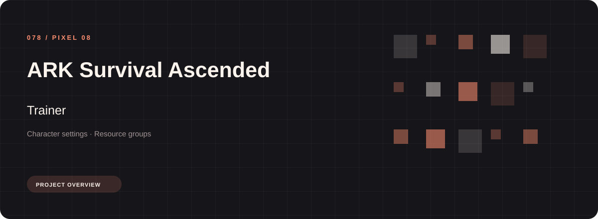
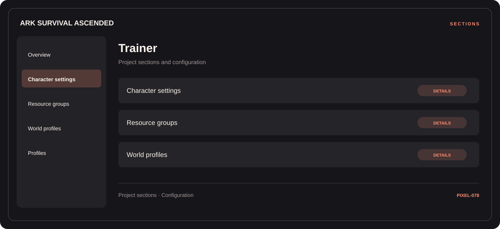

# ⚡ ARK Survival Ascended Trainer

**Character settings · Resource groups · World profiles**

## ⚡ Features

ARK Survival Ascended Trainer uses a concise workspace for character settings, resource groups, and world profiles. The feature map follows the same order as the project navigation.

### ⚙️ Character settings

Character-related parameters and the settings associated with the selected category.

### 🧩 Resource groups

Inventory and resource categories organized alongside their related values and notes.

### ⌨️ World profiles

Related settings collected into named groups for a clearer configuration workflow.

## 🖥️ Project navigation

## 📥 Download

The button and cover open the project's download page. Use the information supplied with the downloaded package for installation and release-specific requirements.

## 📚 Project documentation

- [Feature reference](docs/FEATURES.md)
- [Download information](docs/DOWNLOAD.md)
- [Project page](index.html)

---

ARK Survival Ascended Trainer · Program documentation and download information.
